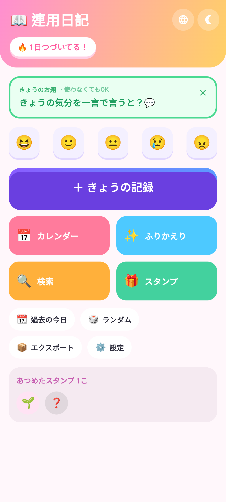
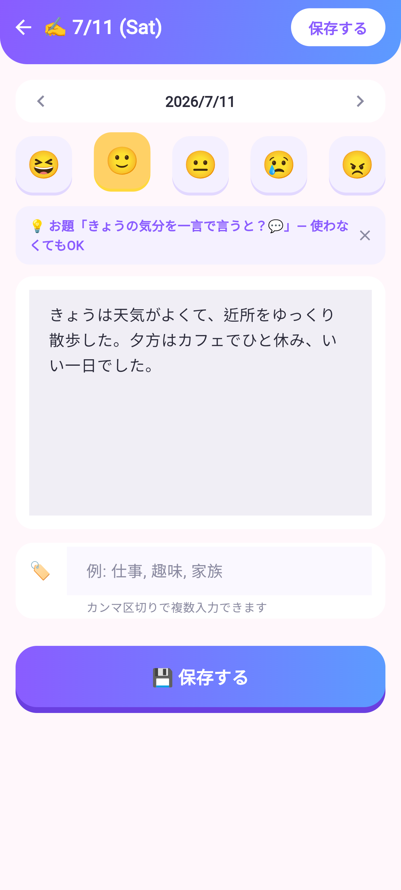
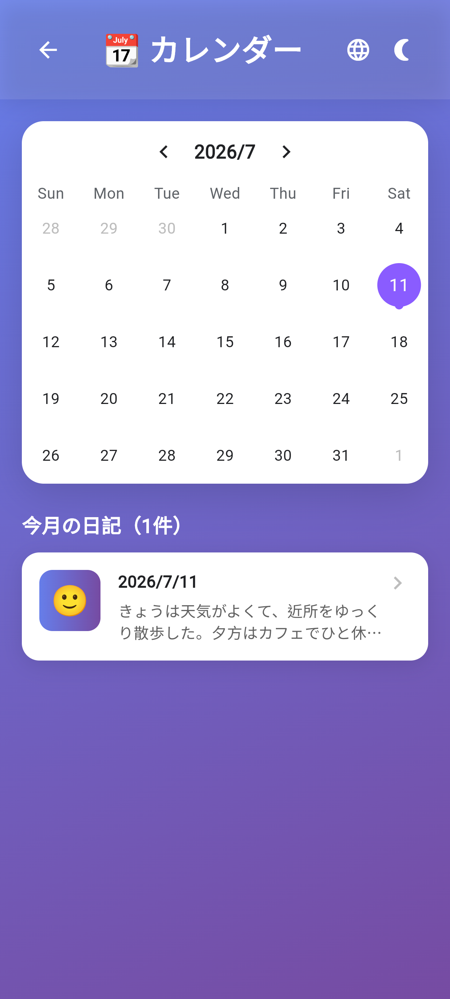

# Daily Diary - Flutter Mobile App

Cross-platform diary app built with Flutter, from concept to Google Play release.

(Flutter製クロスプラットフォーム日記アプリ - 企画からGoogle Playリリースまで)

A laid-back, playful diary you can jot in a snap.

(サッと書けて、ゆるっと続く。ポップな日記アプリ)

## Screenshots

  
  
  

## Features

| Feature | Description |
|---------|-------------|
| **10 Language Support** | 🇯🇵 Japanese, 🇺🇸 English, 🇨🇳 Chinese, 🇰🇷 Korean, 🇪🇸 Spanish, 🇧🇷 Portuguese, 🇮🇳 Hindi, 🇮🇩 Indonesian, 🇫🇷 French, 🇩🇪 German |
| **Dark Mode** | Full dark mode support with system preference detection |
| **Offline-First** | All data stored locally on device — no account needed, works fully offline |
| **Calendar View** | Visual calendar with mood indicators and quick navigation |
| **Mood Stickers** | One-tap mood stickers on the home and writing screens |
| **Daily Prompt** | A light, optional prompt each day — dismiss it anytime, write however you like |
| **Save Celebration** | A little confetti and streak cheer when you save — keeps it fun |
| **Stamp Collection** | Collect reward stamps as you keep writing (entry-count & streak milestones) |
| **Onboarding** | Quick 3-page intro on first launch, re-viewable from settings |
| **Statistics** | Writing streaks, mood breakdown by sticker, and activity — playful, no scoring |
| **Year in Review** | A year of writing in one shareable card (entries, streak, top words) — diary text never included |
| **Search** | Full-text search and tag-based filtering (case-insensitive) |
| **Random Entry** | Rediscover past entries randomly |
| **App Lock** | Biometric / screen-lock protection; FLAG_SECURE blocks screenshots and task-switcher thumbnails |
| **Daily Reminder** | Configurable daily notification to keep the writing habit |
| **Data Backup** | Android Auto Backup + device-transfer enabled, JSON export via share sheet + in-app backup list (restore / delete) |
| **Google Drive Backup (Optional)** | Sign in with Google to back up to your own Drive (app-private appDataFolder) — auto backup after save, restore on any device. The developer can never read it |
| **Screen Reader Support** | Every tappable control is labelled for TalkBack — back, light/dark toggle, month arrows, clear, the mood stickers (announced by name and selection state), and the rest. The save celebration is announced as a live region, number tiles read as one sentence, decorative emoji are excluded, and mood emoji are read as words. `test/a11y_names_test.dart` fails the build if any tappable control ships without a name; a device audit on the CI emulator (`scripts/a11y_device_audit.py`) checks the real accessibility tree the reader receives. Settings carries a short **how to use this with a screen reader** section (where the reading aloud comes from, how to move, and the one thing that cannot be read — the calendar dot). `scripts/a11y_speech_capture.py` records the order and wording a reader actually receives on a device, and `scripts/a11y_tts_measure.py` speaks each label through the device TTS and measures the audio — it runs as a CI gate on every pull request that touches the wording, and it trims the synthesizer's leading and trailing padding before it judges |
| **Kids' Learning Site Link** | Settings links out to the developer's free learning site for kids (arithmetic / shogi / coding). Shown only when the device language is Japanese, because the site is Japanese-only |

## Tech Stack

| Category | Technologies |
|----------|--------------|
| **Framework** | Flutter 3.x, Dart |
| **State Management** | Provider |
| **Local Storage** | Hive (NoSQL) |
| **Cloud Backup** | Google Sign-In (google_sign_in v7) + Google Drive API — `drive.appdata` scope only, user-owned storage |
| **Monetization** | Google AdMob (non-personalized banner ads) |
| **Localization** | Flutter intl (ARB files) |
| **Architecture** | Single-codebase cross-platform |
| **Testing** | flutter_test — unit tests for model + Hive database layer |
| **CI/CD** | GitHub Actions (analyze + test + emulator tests and the signed AAB → Google Play release here; store-listing updates from the private repo) |

## Development Approach

This app was developed using **Claude Code** (AI-assisted development tool by Anthropic).

(このアプリは **Claude Code**（Anthropic社のAI支援開発ツール）を使用して開発しました)

### What Claude Code Helped With:
- UI/UX implementation with consistent design patterns
- Multi-language localization (10 languages, 281 keys)
- Dark mode implementation across all screens
- Bug fixing and code quality improvements
- Google Play Store preparation

### What I Did:
- Product concept and feature planning
- Design decisions and user experience direction
- Testing on physical devices
- Google Play Console setup and submission
- Code review and quality assurance

> This project demonstrates effective collaboration between human creativity and AI assistance in modern app development.
>
> (このプロジェクトは、現代のアプリ開発における人間の創造性とAI支援の効果的なコラボレーションを示しています)

## Project Evolution

This is the mobile app version of my earlier web application:

| Version | Platform | Repository |
|---------|----------|------------|
| **Web App** | Google Apps Script | [gas-daily-diary](https://github.com/yasumorishima/gas-daily-diary) |
| **Mobile App** | Flutter (Android/iOS) | This repository |

The Flutter version adds offline capability, native performance, and multi-language support while maintaining the same user experience philosophy.

## Repositories

| Repository | What is there |
|---|---|
| **This repository** (public) | The app source, the tests and the CI that checks every change |
| [daily-diary](https://github.com/yasumorishima/daily-diary) 🔒 *(private)* | The store listing and screenshots, and the design notes and history up to v1.0.42 |

The production AdMob IDs are not in this repository's source: they are Secrets of the `production` environment, used only by the release workflow. Other builds use Google's test ad IDs, and a release build made without the production IDs shows no ads.

## CI/CD

GitHub Actions in this repository:

- **Flutter CI** (`flutter-ci.yml`): `flutter analyze` + `flutter test` + a debug APK build on every push and pull request to `main` (and on pushes to `ccr-**` cloud-session branches), and a check that `pubspec.lock` is up to date
- **Release** (`release.yml`): when a push to `main` carries a `pubspec.yaml` version that has no `v<version>` tag yet (i.e. a version-bump PR is merged), builds the signed release AAB, checks that it carries the production AdMob IDs and the upload-key signature (`scripts/build_release.sh`), publishes it to Google Play production and tags `v<version>`. A manual run with `publish` off does the same build and checks without publishing. Signing keys, the service account and the AdMob IDs are Secrets of the `production` environment, which only `main` can use
- **Integration Test** (`integration-test.yml`): Android emulator (API 34, KVM) — a device audit of every screen (each tappable control must have a name), home screenshots in three themes/languages, and the E2E flow (mood sticker → write & save → save celebration → stamp collection)
- **A11y TTS measure** (`a11y-tts.yml`): on pull requests that change the strings or the probe, the emulator's TTS reads the screen-reader strings and the audio is measured (TalkBack itself is not in the emulator image)
- **A11y speech capture** (`a11y-speech.yml`): manual dispatch → collects what a screen reader would receive (order, text, live-region events) through a profile-only accessibility service
- **Flutter update check** (`flutter-update-check.yml`): weekly; when a newer stable Flutter is out, it tries pub get / analyze / test / a debug build with it and opens an issue with the results

The store listing and screenshot updates run from the private repository.
📝 [Build setup article (Japanese)](https://zenn.dev/shogaku/articles/flutter-android-build-github-actions)

## Status

**Google Play:** [Published](https://play.google.com/store/apps/details?id=com.diary.daily) (Available in 147 countries; not distributed in the EEA or the UK since 2026-11-10)

## Privacy

- All diary entries are stored locally on your device by default — nothing leaves your device unless you opt in
- Optional Google Drive backup (v1.0.27+) stores your diary only in your own Google Drive (app-private area, `drive.appdata` scope) — the developer has no server and can never read or collect your diary
- Ads are served via Google AdMob (non-personalized); like most ad SDKs it collects an advertising ID and approximate (IP-based) location — see the Privacy Policy
- [Privacy Policy](https://yasumorishima.github.io/diary-app-flutter-privacy/)

---

*Built with Flutter and Claude Code*

